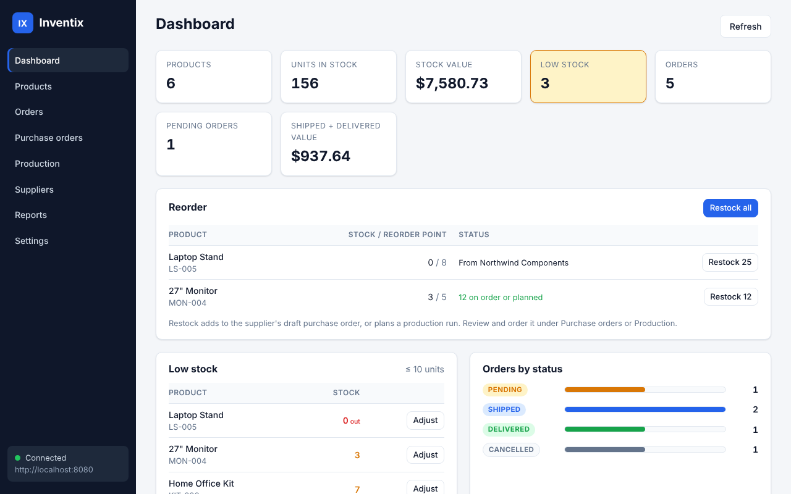
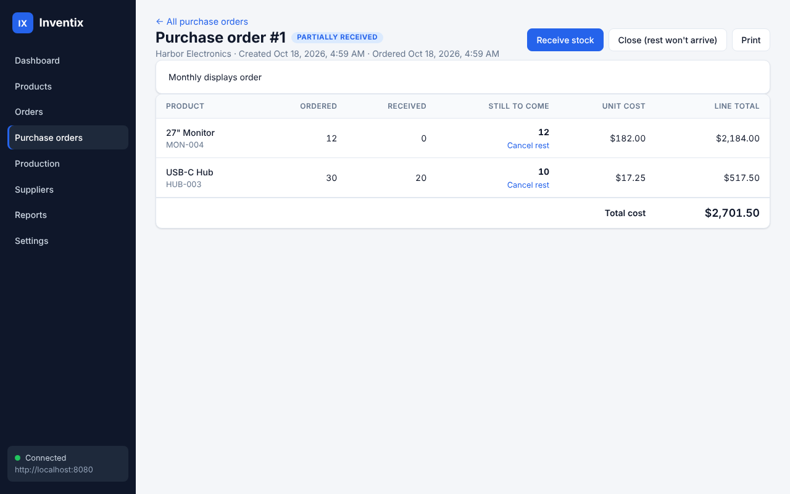
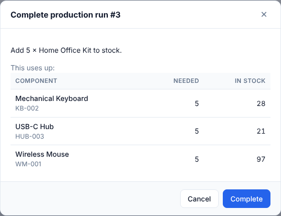
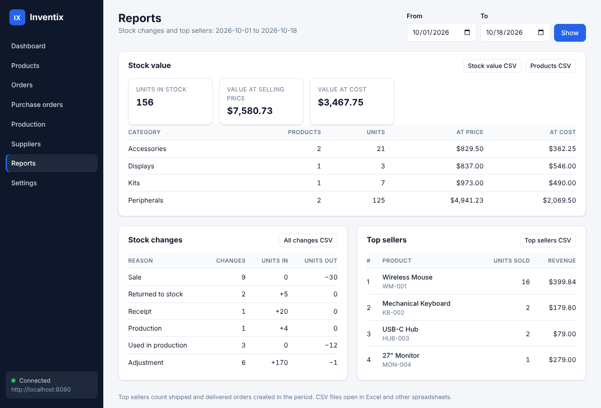

<div align="center">


# Inventix

**Know what's on the shelf, what's on its way and what to reorder, on your own computer.**

Inventix is an inventory app for a small business run from one computer: a Spring Boot backend that keeps the data in a local file, and a desktop window (Tauri 2) on top of it. It tracks products and stock, customer orders, suppliers and purchase orders, in-house production with bills of materials, and reports with CSV export. Every stock change goes in a ledger with its reason, stock never goes below zero, and the API only answers on `127.0.0.1`, so there's no login and nothing to host.

[How to use it](#how-to-use-it) · [Quick start](#quick-start) · [How it works](#how-it-works) · [Configuration](#configuration) · [Data](#data) · [Deploy](#deploy)

[](https://github.com/emmanuelalozie/inventory-manager/actions/workflows/ci.yml)    



</div>

## Why use it

- **Stock adds up.** Every change (a sale, a cancellation, a receipt, a production run, the components it used, a manual adjustment) writes a movement with its reason, time, note and the order behind it. A manual adjustment needs a note, a change that would take stock below zero is refused, and two edits of the same product at once can't overwrite each other (the second gets a 409 and reloads).
- **Orders hold stock.** Adding an item to a pending order takes the stock straight away, and lowering, removing or cancelling gives it back. The unit price is fixed when the item is added. Shipped and delivered orders are kept as a record and can't be deleted, and a retried create with the same `Idempotency-Key` returns the first order instead of making a second.
- **Restocking is a draft, not a surprise.** Each product is bought from a supplier or made in-house, with a reorder point and quantity. Restock (or Restock all) adds the reorder quantity to that supplier's draft purchase order or plans a production run, and counts what's already on order, so nothing is bought or made until you say so.
- **Deliveries can come in parts.** A purchase order is received in as many parts as arrive, each part adds stock and updates the product's unit cost, and the rest of a line (or the whole order) can be closed when it won't come. It prints as a clean page for the supplier.
- **Production uses up its parts.** A made product can list its components. Completing a run shows what it will use, and if one is short nothing changes at all.
- **Reports answer the money questions.** Stock value at selling price and at cost per category, stock changes per reason and top sellers for any range of days, and CSV downloads of each that open straight in Excel.
- **Your data stays yours.** It's an H2 file in your own user folder, not in the project folder, with one-click backups to a `.zip` and a restore that keeps the database it replaces. Caveats: it's for one user on one machine (any program on that computer can call the API), backups are never cleaned up and sit on the same disk, and the desktop window doesn't start the backend for you yet.



## How to use it



1. **Start the backend.** `.\gradlew.bat bootRun` from the repository (see [Quick start](#quick-start)). The first start adds five sample products so the screens aren't empty.
2. **Open the app.** `npm run dev` in `desktop\` opens the window. The light at the bottom of the sidebar says whether it reached the backend.
3. **Set up what you sell.** In Products, give each product a category, a unit cost, and under Restocking whether it's bought (and from which supplier) or made, with its reorder point and quantity. Made products get their components from the Components button.
4. **Sell and restock.** Take customer orders in Orders. When the dashboard's Reorder card lists a product, press Restock, then review and send the draft in Purchase orders, or complete the planned run in Production.
5. **Look back.** Reports shows value and movement for any range of days, and each product's History lists every change to its stock.

<br clear="right" />

| Task | Where |
| --- | --- |
| Add, edit, delete or search products | Products |
| Add or take away stock by hand, with a note | Stock, on the product (or Adjust on the dashboard's low-stock list) |
| See every change to a product's stock | History, on the product |
| Manage categories, or filter products by one | Categories, and the category filter, in Products |
| Take an order, change items, ship, deliver or cancel | Orders |
| See what needs reordering and fill drafts for it | The dashboard's Reorder card: Restock or Restock all |
| Send, receive, close, cancel or print a purchase order | Purchase orders |
| Stop waiting for the rest of one purchase order line | Cancel rest, on the line |
| List a made product's components | Components, on the product |
| Plan, complete or cancel a production run | Production |
| Add or edit suppliers | Suppliers |
| Stock value, stock changes and top sellers, or a CSV of each | Reports |
| Change the backend address or the low-stock threshold (10 by default) | Settings |
| Back up now, see the data folder, or restore a backup | Settings |
| Try the API by hand | Swagger UI at `http://localhost:8080/swagger-ui.html` |

<details>
<summary><strong>Stock rules in one minute</strong></summary>

- **Orders:** `PENDING` → `SHIPPED` → `DELIVERED`, or `PENDING` → `CANCELLED`. Only pending orders can be edited, because only they hold stock. Deleting a pending order gives its stock back; shipped and delivered orders can't be deleted.
- **Purchase orders:** `DRAFT` → `ORDERED` → `PARTIALLY_RECEIVED` → `RECEIVED`, with `CLOSED` when the rest won't come and `CANCELLED` before anything arrives. Only drafts can be edited, and receiving more than is still to come is refused.
- **Production runs:** `PLANNED` → `COMPLETED` or `CANCELLED`. Stock changes only on completion.
- **Editing a product never changes its stock.** Use Stock instead, so the change gets a reason and a note.
- **Movement reasons:** `SALE`, `CANCEL` (returned to stock), `RECEIPT`, `PRODUCTION`, `CONSUMPTION` (used in production) and `ADJUSTMENT` (including starting stock).

</details>



## Quick start

You need [JDK 17](https://adoptium.net) for the backend; the Gradle wrapper and the embedded H2 database come with the project, so nothing else is installed. For the desktop window you also need [Node.js](https://nodejs.org) LTS, [Rust](https://rustup.rs) (stable, MSVC toolchain on Windows), [Microsoft C++ Build Tools](https://visualstudio.microsoft.com/visual-cpp-build-tools/) (Desktop development with C++) and WebView2, which Windows 10 and 11 already have; [desktop/README.md](desktop/README.md#prerequisites-windows) has the details.

```powershell
git clone https://github.com/emmanuelalozie/inventory-manager
cd inventory-manager
.\gradlew.bat bootRun              # the backend, on http://localhost:8080

# in a second terminal
cd desktop
npm install                        # the Tauri CLI
npx tauri icon path\to\logo.png    # once: the app icons aren't checked in
npm run dev                        # opens the app window
```

The default branch is `develop`. On macOS or Linux use `./gradlew` instead of `.\gradlew.bat`. The backend logs `Database: ...` with the file it opened. `npm run dev` serves the UI on `http://127.0.0.1:1420` for the window, and the same address works in a normal browser, so you can try the app without Rust: run `npm run serve` instead and open it.

<details>
<summary><strong>Development tools</strong></summary>

- **Backend tests** run against an in-memory H2 database with the same Flyway migrations (`src/test/resources/application.properties`), so they never touch your data. The report is in `build/reports/tests/test/index.html`.
- **Desktop tests** use only Node's built-in test runner, so `npm test` needs no `npm install`.
- **H2 console** at `http://localhost:8080/h2-console`: the JDBC URL is the `Database:` path from the log without `.mv.db`, user `sa`, no password. Changes made there skip the stock ledger.
- **API reference:** [docs/API.md](docs/API.md) has every endpoint, JSON shape, rule and error code; the OpenAPI document is at `http://localhost:8080/v3/api-docs` while the backend runs.

</details>

| Command | What it does |
| --- | --- |
| `.\gradlew.bat build` | Compiles, runs the backend tests and builds the jar: the gate for every change |
| `.\gradlew.bat test` | Backend tests only |
| `.\gradlew.bat bootRun` | Runs the backend from source |
| `cd desktop; npm test` | Desktop tests: the dev server, `helpers.js` and the request shapes in `api.js` |
| `cd desktop; npm run dev` | Runs the app window, starting the UI server on port 1420 first |
| `cd desktop; npm run serve` | The UI server alone, for a normal browser |
| `cd desktop; npm run build` | Release build, with the installers in `desktop/src-tauri/target/release/bundle` |

## How it works

| Part | Built with |
| --- | --- |
| **Backend** | Java 17, [Spring Boot 4.1](https://spring.io/projects/spring-boot) (Spring MVC, Spring Data JPA with Hibernate 7, Bean Validation), Lombok |
| **Database** | [H2](https://h2database.com) 2.4.240 in a file, schema by [Flyway](https://documentation.red-gate.com/flyway) |
| **API docs** | [springdoc-openapi](https://springdoc.org) (Swagger UI) and [docs/API.md](docs/API.md) |
| **App shell** | [Tauri 2](https://v2.tauri.app) |
| **Interface** | Plain HTML, CSS and JavaScript modules in `desktop/src`, with no framework, bundler or outside resources |
| **Tests** | JUnit 5, Mockito, AssertJ and MockMvc; `node --test` for the desktop |

The backend owns every rule: the window only shows what the API returns and sends what you ask, and every check the forms make is made again on the server. Stock only changes through one service method, which writes the ledger entry in the same transaction, and controllers take and return DTOs, never database entities. Every error comes back as one JSON shape (`timestamp`, `status`, `error`, `message`, `path`, and `fieldErrors` for validation), which the window shows as a toast or next to the field.

| Package | What it is |
| --- | --- |
| `config/DataLocation.java`, `DataLocationPostProcessor.java` | The per-user data folder, the one-time copy from the old `./data`, and a pending restore applied before the database opens |
| `config/WebConfig.java`, `OpenApiConfig.java`, `DataSeeder.java` | CORS for the window, the Swagger description, the sample products on a first start |
| `service/impl/ProductServiceImpl.java` | Products and `adjustStock`, the one place stock changes, with its ledger entry |
| `service/impl/OrderServiceImpl.java`, `OrderItemServiceImpl.java` | Orders, their items and statuses, reserving and returning stock, idempotent creates |
| `service/impl/PurchaseOrderServiceImpl.java` | Purchase orders: drafts, receipts in parts, cancelling the rest of a line, closing |
| `service/impl/ProductionRunServiceImpl.java`, `BillOfMaterialsServiceImpl.java` | Production runs and the components they use up, with loop checks |
| `service/impl/RestockServiceImpl.java` | The reorder list and Restock |
| `service/impl/ReportServiceImpl.java`, `export/CsvWriter.java` | Stock value, movements and top sellers; CSV with a byte order mark for Excel |
| `service/impl/BackupServiceImpl.java` | Backups to `.zip` and scheduling a restore |
| `service/impl/CategoryServiceImpl.java`, `SupplierServiceImpl.java`, `StockMovementServiceImpl.java` | Categories, suppliers, reading the ledger |
| `controller/`, `dto/` | The REST endpoints under `/api` and their request and response records |
| `exception/GlobalExceptionHandler.java` | Turns every exception into the JSON error body |
| `src/main/resources/db/migration/` | Flyway migrations `V1` to `V8` |
| `desktop/src/js/main.js`, `api.js`, `ui.js`, `helpers.js` | Routing and the connection light; every endpoint; toasts, dialogs and formatting; pure helpers the tests cover |
| `desktop/src/js/dashboard.js`, `products.js`, `orders.js`, `purchase-orders.js`, `production.js`, `suppliers.js`, `reports.js`, `settings.js` | One file per screen |
| `desktop/scripts/dev-server.js` | The dependency-free UI server on port 1420 |

All Java packages are under `src/main/java/com/example/inventix`.

**Stock and the ledger.** `adjustStock` locks nothing up front; instead each product has a version number, so two changes at the same moment can't both win, and the loser gets a 409 asking to reload. A change that would take stock below zero or past the largest whole number is refused before anything is written. Starting stock is recorded as an `ADJUSTMENT`, so the ledger always adds up to what's on the shelf.

**Restock.** The reorder list holds products at or below their reorder point, with what's still to come on draft, ordered and partly received purchase orders and planned runs. Restock all skips a product that's already covered, has no reorder quantity, or is bought without a supplier, and says why. Restock adds a line to the supplier's newest draft (or starts one) and never adds the same product twice; for a made product it plans one run unless one is already planned.

**Receiving and cost.** A receipt is checked as a whole first, so one bad line books nothing. Each line adds stock with a `RECEIPT` movement that points back to the purchase order, and a line with a unit cost sets the product's unit cost to it (last purchase cost), which the stock value at cost uses.

**Security.** The server binds to `127.0.0.1` and has no login, by design: Inventix has one user on one machine. Browsers can only call the API from the Tauri window and the local UI servers (CORS), and the window's content security policy only lets it talk to `localhost`. Add authentication before ever putting it on a network.

Each change goes on a branch from `develop` with a pull request. [docs/REVIEW.md](docs/REVIEW.md) is the running review: what was fixed, what's still open and why.

<details>
<summary><strong>How this project is built</strong></summary>

- **Pull requests:** CI (`.github/workflows/ci.yml`) runs `./gradlew build` on JDK 17 and the desktop tests on Node 22, and GitHub's CodeQL default setup scans the code.
- **Reviews:** each feature is tried in the real app (backend jar plus the UI in a headless browser) before its pull request opens, and the review file records open problems with a recommendation.
- **Releases:** none yet. The backend is `0.0.1-SNAPSHOT` in `build.gradle` and the desktop is `0.1.0` in `desktop/package.json` and `desktop/src-tauri/tauri.conf.json`.

</details>

## Configuration

Settings live in `src/main/resources/application.properties`, with a comment on each one. Spring Boot lets an environment variable override any of them (`inventix.seed-data` becomes `INVENTIX_SEED_DATA`), so you don't have to edit the file. The desktop window keeps its own two settings, the backend address and the low-stock threshold, in its local storage.

| Variable | Default | Purpose |
| --- | --- | --- |
| `INVENTIX_HOME` | `%LOCALAPPDATA%\Inventix`, `~/Library/Application Support/Inventix` or `~/.local/share/inventix` | The folder for the database and backups |
| `INVENTIX_DATA_DIR` | `{home}/data` | The database folder alone |
| `INVENTIX_BACKUP_DIR` | `{home}/backups` | Where backups are written |
| `INVENTIX_CORS_ALLOWED_ORIGINS` | The Tauri window and `http://127.0.0.1` / `localhost` on ports 1420 and 5500 | Comma-separated origins allowed to call `/api/**` from a browser. Setting it replaces the list. |
| `INVENTIX_SEED_DATA` | `true` | Add five sample products on a first start, when there are none |
| `SERVER_PORT` | `8080` | The backend's port. The window's Settings must point at the new one. |

## Data

Everything is kept in a per-user folder, whatever folder the backend is started from: `%LOCALAPPDATA%\Inventix` on Windows, `~/Library/Application Support/Inventix` on macOS and `$XDG_DATA_HOME/inventix` (or `~/.local/share/inventix`) on Linux, all shown in the window's Settings. It holds `data/inventix.mv.db` (the H2 database, which only one process may open at a time, so use the H2 console or a backup rather than opening or copying the file while the backend runs) and `backups/inventix-backup-<yyyyMMdd-HHmmss>.zip` (from Back up now or `POST /api/backup`, safe while the app is in use and never deleted automatically). Restoring writes `data/restore-pending.txt`; on the next start, before the database opens, the backup is put in place and the database it replaces is kept as `data/inventix-before-restore-<timestamp>.mv.db`, and until then the restore can be cancelled. Older versions kept the database in `./data` under the start folder: on the first start from there, it's copied (not moved) to the new folder and the log says so, and old backups stay where they were. The schema is built by Flyway migrations `V1` to `V8` in `src/main/resources/db/migration`, which also bring a restored older backup up to date, and Hibernate only checks that the entities match it. H2 is pinned to 2.4.240, which also opens databases and backups from the 2.2.224 that earlier versions used. It's pinned rather than left to Spring Boot because some H2 versions change the file format, and crossing such a change needs an export and re-import ([O-13 in the review](docs/REVIEW.md#o-13-h2-file-format-changes-on-upgrade)).

## Deploy

Inventix isn't a hosted service, and no builds are published yet: you build it from source. The backend is a single jar that needs Java 17, and the desktop window is built into installers on the system it runs on. The window doesn't start the backend, so start the jar first (shipping both as one app is on the roadmap). Generate the icons with `npx tauri icon` before the first desktop build.

| System | File | Notes |
| --- | --- | --- |
| Any, with Java 17 | `build/libs/inventix-0.0.1-SNAPSHOT.jar` | From `.\gradlew.bat build`; run it with `java -jar` |
| Windows | `Inventix_0.1.0_x64-setup.exe`, `Inventix_0.1.0_x64_en-US.msi` | From `npm run build` in `desktop\`, under `src-tauri/target/release/bundle` |
| Linux | `Inventix_0.1.0_amd64.deb`, `Inventix_0.1.0_amd64.AppImage` | Same command, on Linux with WebKitGTK; not tried yet |
| macOS | `Inventix.app`, `Inventix_0.1.0_<arch>.dmg` | Same command, on a Mac; not tried yet |

## Credits and license

The repository is public but has no license file, so it isn't open source: all rights are reserved by default. The desktop UI bundles no outside JavaScript, CSS or fonts. The backend's dependencies are listed in `build.gradle` and the desktop shell's in `desktop/src-tauri/Cargo.toml`.
